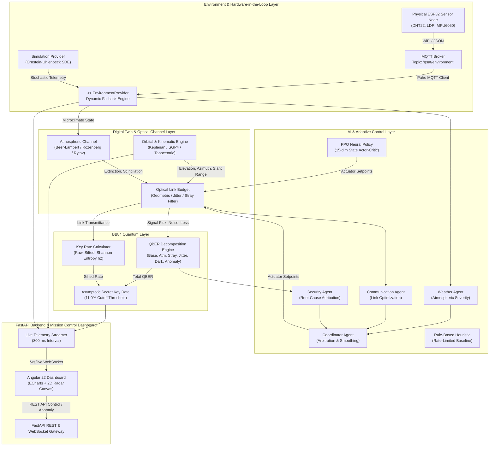

# Q-SAT Adaptive Ground Station — System Architecture

This document provides the authoritative system architecture for the **Q-SAT Adaptive Ground Station**, detailing the end-to-end data pipeline, module interfaces, threading and concurrency model, and hardware abstraction layer.

---

## 1. High-Level System Architecture



---

## 2. Component Subsystems

### 2.1 Environment & Hardware Abstraction Layer
The environment subsystem decouples sensor telemetry acquisition from downstream physical modeling:
- **`EnvironmentProvider` Interface**: Defines contract `get_readings() -> EnvironmentReading` and `get_source_label() -> str`.
- **`SimulationEnvironmentProvider`**: Implements Ornstein-Uhlenbeck stochastic differential equations ($dX_t = \theta(\mu - X_t)dt + \sigma dW_t$) for continuous, physically bounded drift in temperature, relative humidity, ambient illuminance, and mount vibration.
- **`MQTTEnvironmentProvider`**: Subscribes to MQTT broker topic `qsat/environment`. Receives live JSON packets from the ESP32 node. Maintains a 3-second heartbeat watchdog; if hardware disconnects, it gracefully reverts to numerical simulation without interrupting operation.

### 2.2 Digital Twin & Optical Channel Layer
- **`OrbitalModel`**: Computes Keplerian two-body orbit at $500\text{ km}$ circular altitude, Rozenberg airmass $m(\theta) = [\sin\theta + 0.025 \exp(-11 \sin\theta)]^{-1}$, topocentric elevation/azimuth coordinates, and slant range relative to Ground Station Tiruchirappalli ($10.7905^\circ\text{ N}, 78.7047^\circ\text{ E}, 80\text{ m}$).
- **`AtmosphericModel`**: Evaluates Beer-Lambert optical extinction $\tau_{\text{atm}} = \exp(-\beta_{\text{ext}} m(\theta))$, cloud optical depth attenuation, and Rytov scintillation turbulence variance $\sigma_R^2 = 1.23 C_n^2 k^{7/6} d^{11/6} m(\theta)^{11/6}$.
- **`OpticalChannel`**: Models Gaussian beam divergence, receiver telescope aperture collection fraction ($D_{\text{rx}} = 0.30\text{ m}$), mount pointing jitter loss ($\eta_{\text{jitter}} = \exp(-\theta_{\text{jitter}}^2 / 2\theta_{\text{div}}^2)$), and spectral bandpass filtering of ambient stray photons ($0.15\text{ counts/s/lux}$).

### 2.3 BB84-Inspired QKD Engine
- **`QBERCalculator`**: Decomposes total error into six isolated physical causes:
  $$e_{\text{total}} = e_{\text{base}} + e_{\text{atm}} + e_{\text{stray}} + e_{\text{vibe}} + e_{\text{dark}} + \Delta e_{\text{anomaly}}$$
- **`KeyRateCalculator`**: Calculates raw photon flux and $50\%$ basis sifting.
- **`SecretKeyRateCalculator`**: Computes binary Shannon entropy $h_2(e) = -e \log_2(e) - (1-e)\log_2(1-e)$ and asymptotic secret key rate:
  $$R_{\text{SKR}} = \max\left(0, R_{\text{sift}} [1 - f(e)h_2(e) - h_2(e)]\right)$$
  Enforcing an immediate security cutoff at $e \ge 11.0\%$.

### 2.4 AI & Adaptive Control Layer
Supports four interchangeable controller architectures:
1. `STATIC`: Constant baseline setpoints.
2. `RULE_BASED`: Elevation- and QBER-responsive expert heuristic with rate-of-change clamping.
3. `PPO`: Continuous 15-dimensional observation Actor-Critic policy trained via Proximal Policy Optimization.
4. `MULTI_AGENT`: Hierarchical multi-agent network (Weather, Communication, Security, Coordinator) featuring root-cause anomaly attribution.

---

## 3. Communication & Data Flow

### 3.1 Live WebSocket Protocol (`/ws/live`)
Broadcasts a complete JSON telemetry frame every $800\text{ ms}$:
```json
{
  "timestamp": 1726834000.8,
  "satellite": { ... },
  "environment": { "source": "SIMULATION", ... },
  "channel": { ... },
  "qkd": { "secret_key_rate_bps": 752.4, "qber_pct": 3.45, ... },
  "control": { "mode": "MULTI_AGENT", ... },
  "ai_agents": { ... },
  "alerts": [ ... ]
}
```

### 3.2 REST API Specification
- `GET /api/system/status`: Overall system health and active controller.
- `POST /api/control/switch`: Switch active controller (`STATIC`, `RULE_BASED`, `PPO`, `MULTI_AGENT`).
- `POST /api/simulation/scenario`: Switch active environment scenario (Scenarios A through F).
- `POST /api/qkd/inject-anomaly`: Inject artificial eavesdropping anomaly ($\Delta e$).
- `POST /api/qkd/clear-anomaly`: Clear injected anomaly.
- `GET /api/experiments/results`: Retrieve benchmark comparison results.
